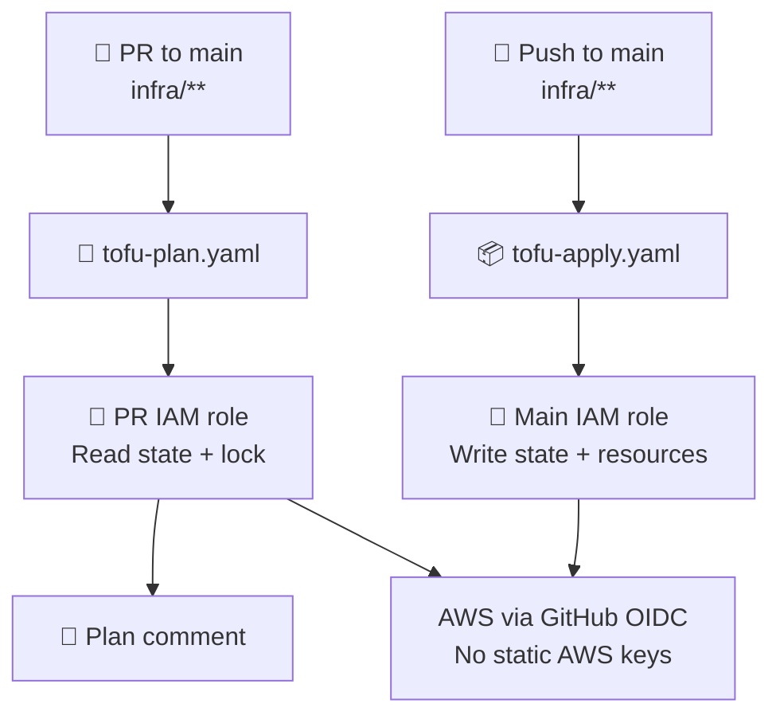

# tofu-github-playground

A hands-on demo of managing GitHub repositories with **OpenTofu + GitHub Actions**, using **AWS S3** for remote state.

Everything is managed as code in `infra/`: repository settings, branches, rulesets, Actions permissions, secrets, OIDC roles, and the state bucket.

**🔑 Only manual setup required:** adding the GitHub Personal Access Token (`GH_PAT`) as a repository secret. Everything else is provisioned by OpenTofu.

## ⚙️ How it works

